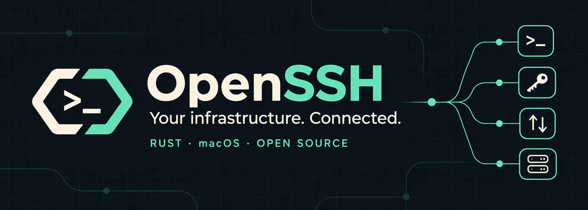
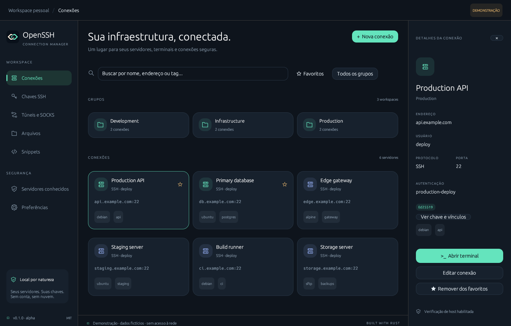
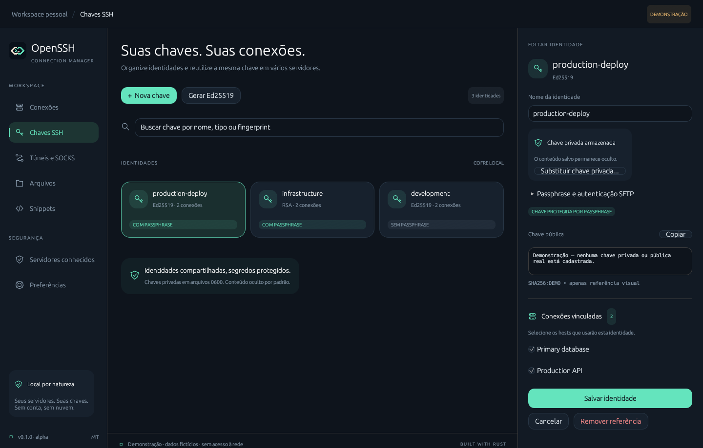

<p align="center">
  
</p>

<h1 align="center">OpenSSH Manager</h1>
<p align="center">Suas conexões. Suas chaves. Seu ambiente.</p>
<p align="center">Um workspace desktop open source para SSH, túneis e transferência de arquivos, escrito em Rust.</p>

<p align="center">
  <a href="https://www.rust-lang.org/"></a>
  <a href="https://github.com/emilk/egui"></a>
  <a href="https://www.apple.com/macos/"></a>
  <a href="LICENSE"></a>
  <a href="specs/001-native-workspace/spec.md"></a>
</p>



> **Alpha 0.1.0.** Projeto em desenvolvimento, sem auditoria independente de segurança. Comece com hosts de teste. Este projeto é independente e não é afiliado ao projeto OpenSSH do OpenBSD, nem ao Termius.

## Visão do projeto

O OpenSSH Manager reúne conexões, identidades, terminais, encaminhamentos de portas e arquivos em um aplicativo nativo. O foco inicial é macOS, com interface e lógica em Rust, sem Electron ou servidor de aplicação. Os fluxos de organização de hosts são inspirados em ferramentas como Termius; a identidade visual e a implementação são próprias.



A captura usa o modo de demonstração. Endereços `example.com` e informações de exemplo não representam ambientes reais. O logo e o banner são imagens geradas por IA; os prompts e a origem ficam em [Identidade visual](docs/branding.md).

## Recursos e limites

| Área | Alpha inicial | Próximos passos |
| --- | --- | --- |
| Hosts | Cadastro, edição, grupos, tags, favoritos e busca local | Importação de `~/.ssh/config`, operações em lote |
| Terminal SSH | Sessão integrada por PTY usando o cliente SSH do sistema | Seleção avançada, busca, maior compatibilidade de terminal |
| Identidades | Editor lateral; importação por arquivo/texto; Ed25519 com passphrase opcional; chave pública e fingerprint derivados; vínculos com vários hosts | Certificados e integração com hardware |
| Senhas e passphrases | Senha por host e passphrase opcional por identidade no Keychain para SFTP | Fluxos unificados de autenticação |
| Túneis | SOCKS5, encaminhamento local e remoto via SSH | Monitoramento, reconexão e dependências entre túneis |
| Arquivos | Listagem, upload e download de arquivos via SFTP e FTP | Fila com progresso, cancelamento e operações recursivas |
| Snippets | Cadastro, edição e cópia de comandos; execução manual | Organização e integração com sessões |
| Segurança do servidor | SSH confirma novas chaves; SFTP exige `known_hosts` válido | Gerenciador visual de confiança |
| Dados | Workspace JSON local, gravação atômica e permissões restritas | Migrações de schema e exportação protegida |
| Plataformas | macOS como alvo inicial | Validação e empacotamento de Linux e Windows |

FTP comum transmite credenciais e arquivos sem criptografia. Seu uso exige confirmação explícita no aplicativo. Prefira SFTP sempre que possível. FTPS ainda não é oferecido.

A alpha não oferece sincronização em nuvem, colaboração, Touch ID, FIDO2, reconexão automática ou equivalência completa com terminais maduros. O editor aceita chaves OpenSSH protegidas mediante passphrase correta. A passphrase pode ser salva no Keychain para SFTP; terminal SSH e túneis continuam pedindo-a interativamente. Chaves privadas ficam em arquivos locais com permissão `0600`; **não** são armazenadas no Keychain. Os metadados do workspace não são criptografados.

## Executar no macOS

### Pré-requisitos

- macOS com as ferramentas de desenvolvimento da Apple (`xcode-select --install` se necessário).
- Toolchain Rust estável por [rustup](https://rustup.rs/), com `rustfmt` e `clippy`.
- Cliente SSH do sistema (`/usr/bin/ssh` e `/usr/bin/ssh-keygen`).

```bash
git clone https://github.com/jeffersonmello/OpenSSH.git
cd OpenSSH
cargo run --locked
```

Para conhecer a interface sem criar conexões reais:

```bash
cargo run --locked -- --demo
```

O modo de demonstração usa um workspace em memória e bloqueia conexões de rede. Para usar seus próprios servidores, reinicie sem `--demo`.

### Primeira conexão

1. Cadastre nome, endereço, usuário e porta de um host de teste.
2. Em **Chaves**, importe uma chave por arquivo ou texto, ou gere Ed25519 com passphrase opcional. Confira o fingerprint e selecione os hosts SSH/SFTP que usarão essa identidade. Também é possível escolher a chave no editor de cada conexão, ou usar seu `ssh-agent`.
3. Abra o terminal SSH. Na primeira conexão, confira o fingerprint do servidor por um canal confiável antes de aceitar a chave.
4. Para SFTP, abra **Arquivos → Verificar servidor via SSH** e valide o fingerprint no terminal. A transferência rejeita chaves desconhecidas ou alteradas.
5. Cadastre um túnel e inicie a sessão correspondente. SOCKS usa um listener local; configure seu cliente para SOCKS5 em `127.0.0.1:<porta>` e resolução DNS pelo proxy, quando suportado.

Conexões gerenciadas ignoram `~/.ssh/config` (`-F /dev/null`), preservando `known_hosts` e `ssh-agent`. Informe o hostname ou IP real; aliases, `ProxyCommand` e regras de jump host desse arquivo ainda não são importados.

Senhas solicitadas pelo terminal são digitadas na própria sessão; a senha salva para transferências não é injetada no cliente SSH. Nunca cole chaves privadas em issues, screenshots ou arquivos do repositório.

Uma identidade pode ser compartilhada por vários hosts. Renomeá-la ou substituir seu material mantém os vínculos; a substituição afeta as próximas autenticações de todos eles. Desmarcar um host remove apenas sua associação. Hosts FTP não usam identidades SSH.

Excluir uma identidade remove seu cadastro e vínculos, preservando o arquivo privado no disco. Senhas salvas podem ser removidas pelo botão **Esquecer senha salva** no editor do host; excluir o cadastro do host não apaga automaticamente sua entrada do Keychain.

### Gerenciar chaves e conexões



Abra **Chaves** para ver as identidades em cartões e selecione uma para abrir o editor lateral. Cadastre uma chave por arquivo ou cole o material privado no campo mascarado. Na geração Ed25519, uma passphrase opcional protege o arquivo criado. Para importar OpenSSH protegido, informe a passphrase; chave pública e fingerprint são derivados do material validado e ficam disponíveis para conferência.

Ao editar uma identidade existente, o conteúdo salvo permanece oculto. Use **Substituir chave privada...** para fornecer outro material; o campo vazio mantém a chave atual. Alterar somente o nome preserva o material e os vínculos. Para trocar a chave, forneça o novo material e sua passphrase quando necessária: o ID continua o mesmo e as conexões associadas passam a usar a nova chave nas próximas autenticações.

No editor da identidade, selecione os hosts SSH/SFTP que devem usá-la. Cada host aceita uma identidade; ao selecionar um que já usa outra, confira a indicação de substituição antes de salvar. Desmarcar uma conexão desfaz apenas essa associação. O editor do próprio host também oferece seleção por nome, algoritmo e fingerprint, com acesso ao gerenciamento de chaves.

Na identidade existente, expanda **Passphrase e autenticação SFTP** para guardar ou esquecer a passphrase. Informar apenas a passphrase valida a chave já salva antes de atualizar o Keychain; editar somente nome ou vínculos preserva a credencial existente. Ao substituir o material sem guardar uma nova passphrase, a credencial antiga é removida depois de salvar o cadastro.

A opção de guardar passphrase no Keychain vale para o SFTP. Terminal SSH e túneis continuam usando os prompts do cliente SSH e seu `ssh-agent`. O cadastro não oferece certificados, Touch ID ou FIDO2 nesta versão. A importação aceita arquivos de até 1 MiB; chaves protegidas precisam estar no formato OpenSSH e têm limite de 1024 rodadas bcrypt. PEM legado sem proteção continua compatível quando aceito pelo `ssh-keygen` do sistema.

### Gerar um aplicativo `.app`

```bash
./scripts/bundle-macos.sh
open "dist/OpenSSH Manager.app"
```

Para compilar outra arquitetura, instale o target e passe-o ao script:

```bash
rustup target add aarch64-apple-darwin
./scripts/bundle-macos.sh aarch64-apple-darwin
```

O pacote local recebe assinatura ad hoc, sem identidade Apple Developer ou notarização. Não há instalador publicado por esta alteração. Leia o [guia de desenvolvimento](docs/development.md) antes de distribuir builds.

## Desenvolvimento

```bash
./scripts/check.sh
```

O script executa formatação, Clippy e testes com `Cargo.lock`. Testes de rede, Keychain e interface têm cenários explícitos em [Validação](docs/testing.md); testes unitários não substituem a validação em servidores reais.

```text
src/
  app.rs          navegação e coordenação das tarefas
  app/keys.rs     grade, editor lateral e persistência de identidades
  app/keys/tests.rs  testes de máscara, clipboard e histórico do editor
  models.rs       entidades e schema do workspace
  storage.rs      persistência local
  vault.rs        identidades e Keychain
  connection.rs   argumentos seguros para o cliente SSH
  terminal.rs     PTY, parser VT100 e entrada de teclado
  transfer.rs     adaptadores SFTP e FTP
specs/            requisitos, plano, tarefas e critérios de aceite
docs/             arquitetura, decisões, segurança e operação
.agents/skills/   skills locais para Codex e Claude
.github/          CI, contribuição e templates
```

## Documentação

- [Produto e escopo](docs/product.md)
- [Arquitetura](docs/architecture.md) e [decisões técnicas](docs/adr/README.md)
- [Desenvolvimento e build](docs/development.md)
- [Testes e validação manual](docs/testing.md)
- [Modelo de segurança](docs/security.md) e [reporte de vulnerabilidades](SECURITY.md)
- [Especificação inicial](specs/001-native-workspace/spec.md), [plano](specs/001-native-workspace/plan.md) e [tarefas](specs/001-native-workspace/tasks.md)
- [Editor de chaves e vínculos](specs/002-key-workspace/spec.md), [plano](specs/002-key-workspace/plan.md) e [validação](specs/002-key-workspace/tasks.md)
- [Roadmap](docs/roadmap.md) e [histórico](CHANGELOG.md)
- [Identidade visual](docs/branding.md)

## Trabalhar com agentes

[AGENTS.md](AGENTS.md) orienta o Codex; [CLAUDE.md](CLAUDE.md) usa as mesmas regras de projeto para Claude Code. As skills canônicas ficam em `.agents/skills/` e são disponibilizadas ao Claude por links em `.claude/skills/`:

- `openssh-development`: implementar uma alteração ligando requisito, código e validação.
- `ssh-security-review`: revisar autenticação, confiança do servidor, processos, arquivos e túneis.

O fluxo é **especificar → planejar → implementar → validar → atualizar documentação**. Uma correção pequena pode atualizar a especificação existente; uma mudança de comportamento maior recebe uma nova pasta em `specs/`, a partir de [templates](specs/templates/feature.md).

## Contribuir

Issues, revisões, documentação e contribuições de código são bem-vindas. Consulte [CONTRIBUTING.md](CONTRIBUTING.md) e o [Código de Conduta](CODE_OF_CONDUCT.md). Antes de propor uma grande funcionalidade, descreva o problema e os critérios de aceite em uma issue.

## Licença e autoria

[MIT](LICENSE) · Copyright © 2026 Jefferson Mello Olynyki.

O nome do repositório é OpenSSH; o produto é identificado como **OpenSSH Manager** para deixar explícito seu papel de gerenciador independente. OpenSSH e outras marcas citadas pertencem aos respectivos titulares.
