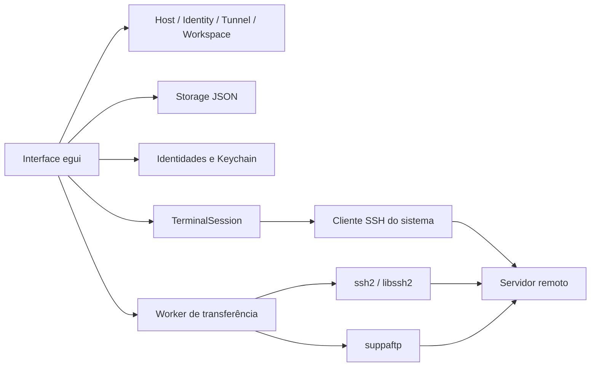

# Arquitetura

O aplicativo é um processo desktop em Rust. `eframe` cria a janela e `egui` desenha a interface. Os modelos de domínio são serializáveis; o armazenamento e os adaptadores de conexão não dependem do estado visual.

## Módulos

| Módulo | Responsabilidade | Não deve fazer |
| --- | --- | --- |
| `models` | Entidades, validação e schema | Abrir sockets ou acessar Keychain |
| `storage` | Diretórios, leitura e gravação atômica | Persistir senhas ou conteúdo de chave privada no JSON |
| `vault` | Importar/gerar identidades, acessar Keychain | Registrar segredos em logs |
| `connection` | Construir argumentos SSH validados | Concatenar comandos para um shell |
| `terminal` | PTY, parser VT100, teclado, resize e ciclo da sessão | Desativar verificação de host |
| `transfer` | Listagem e transferência via SFTP/FTP | Confiar silenciosamente em servidor desconhecido |
| `app` | Navegação, formulários, estado e workers | Bloquear o frame durante uma transferência |
| `app/keys` | Grade, editor, vínculos e confirmação da persistência de identidades | Carregar conteúdo privado salvo automaticamente no editor |

## Duas implementações de transporte

Terminais e túneis executam o cliente SSH do sistema com argumentos separados. Isso mantém prompts e autenticação compatíveis com o ambiente do usuário. O servidor é verificado pelo cliente SSH. A execução usa `-F /dev/null` para isolar regras de `~/.ssh/config`; o arquivo padrão de `known_hosts` e o socket `SSH_AUTH_SOCK` continuam disponíveis. Aliases e jump hosts configurados nesse arquivo não são herdados.

SFTP usa `ssh2` e possui conexão própria. A verificação ocorre antes da autenticação, contra o arquivo `~/.ssh/known_hosts`. Um servidor desconhecido deve ser validado primeiro em uma conexão SSH interativa. Essa separação implica que uma sessão SSH aberta não é reutilizada para SFTP e pode haver diferenças de algoritmos suportados entre OpenSSH e libssh2.

FTP usa `suppaftp` sem TLS nesta versão. A interface exige ciência explícita de que credenciais e arquivos trafegam em claro. FTPS é um item futuro, distinto de SFTP.

## Persistência e segredos

`Workspace` tem `schema_version: 1` e coleções de hosts, identidades, túneis e snippets. Identidades no JSON contêm caminho, chave pública e fingerprint; chaves privadas ficam em arquivos restritos. Senhas de transferência usam entradas do Keychain vinculadas ao identificador do host. Passphrases de chaves OpenSSH podem ser guardadas opcionalmente em entradas por identidade para SFTP; não são injetadas no cliente SSH. `Identity.encrypted` tem padrão `false` na leitura de dados antigos. `Host.identity_id` mantém a associação e o ID de identidade é preservado ao renomear ou substituir material.

`directories::ProjectDirs` resolve o diretório de dados da plataforma. O caminho efetivo é apresentado na interface e pode ser conferido em `Storage::discover`. O workspace é gravado por substituição atômica; um schema desconhecido ou JSON inválido deve produzir erro, sem substituição silenciosa.

O modo `--demo` mantém dados fictícios em memória. Operações de rede e gravação de segredos ficam bloqueadas nesse modo.

## Editor de identidades

A UI separa dados editáveis e metadados derivados. Material privado novo é validado antes de persistir; campos públicos não são fonte de verdade para a chave. `ssh-key` gera Ed25519 com passphrase opcional e valida/descriptografa OpenSSH protegido em memória; o arquivo gerenciado preserva o conteúdo criptografado. Vínculos múltiplos continuam sendo referências nos hosts; FTP é excluído.

`src/app/keys.rs` guarda o rascunho do editor separado da identidade salva. Uma identidade existente mostra um bloco de estado, sem ler sua chave privada, e exige ação explícita para substituir material. O seletor prioriza conexões já vinculadas. A seção de passphrase/SFTP fica recolhida na edição e aberta quando é necessária para um novo material.

Após validar a identidade, a interface salva os metadados antes de executar `PassphraseAction` no Keychain. Renomear ou alterar vínculos mantém a credencial. Substituir material sem optar por guardar uma nova passphrase limpa a credencial antiga; falha de gravação do workspace não dispara essa limpeza. Atualizar só a passphrase valida a chave atual sem gerar outro arquivo privado. Falhas do Keychain após salvar o cadastro são apresentadas para permitir nova tentativa. Veja [SPEC-002](../specs/002-key-workspace/spec.md) e [ADR-0004](adr/0004-protected-identities.md).

## Concorrência e encerramento

Leitura de PTY e transferências ocorrem fora do frame de renderização. O parser mantém uma janela de terminal e histórico limitado. Túneis são processos SSH associados à sessão; fechar a sessão deve encerrar e reaproveitar os recursos do processo. Os workers retornam resultados para a interface por canais.

A alpha não promete cancelamento imediato de transferências já iniciadas. Timeouts limitam falhas de transporte; uma fila com cancelamento e progresso granular está no roadmap.

## Evolução

Preserve a separação entre modelos, persistência e adaptadores ao adicionar plataformas. Novas regras de schema precisam de estratégia explícita de migração. Veja [ADR-001](adr/0001-native-rust.md), [ADR-002](adr/0002-system-ssh.md) e [ADR-003](adr/0003-local-data.md).

## Referências técnicas

- [eframe 0.31.1](https://docs.rs/eframe/0.31.1/eframe/): ciclo de vida e criação da janela.
- [portable-pty 0.9](https://docs.rs/portable-pty/0.9.0/portable_pty/): processo e pseudo-terminal.
- [vt100 0.15](https://docs.rs/vt100/0.15.2/vt100/): parser de tela.
- [ssh2](https://docs.rs/ssh2/0.9.7/ssh2/): sessões e SFTP sobre libssh2.
- [suppaftp 6.3](https://docs.rs/suppaftp/6.3.0/suppaftp/): FTP.
- [keyring 3.6](https://docs.rs/keyring/3.6.3/keyring/): backend nativo de credenciais.

As versões exatas utilizadas no build são as resolvidas em `Cargo.lock`; links de documentação não substituem o lockfile.
